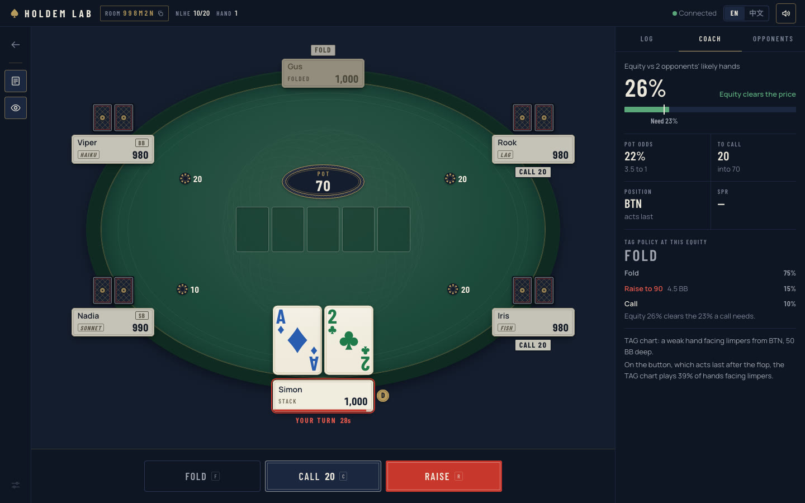
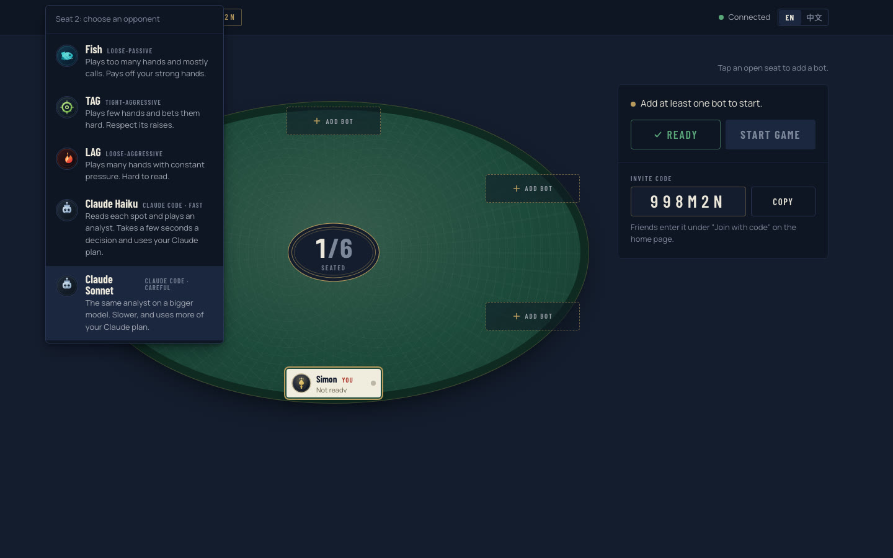
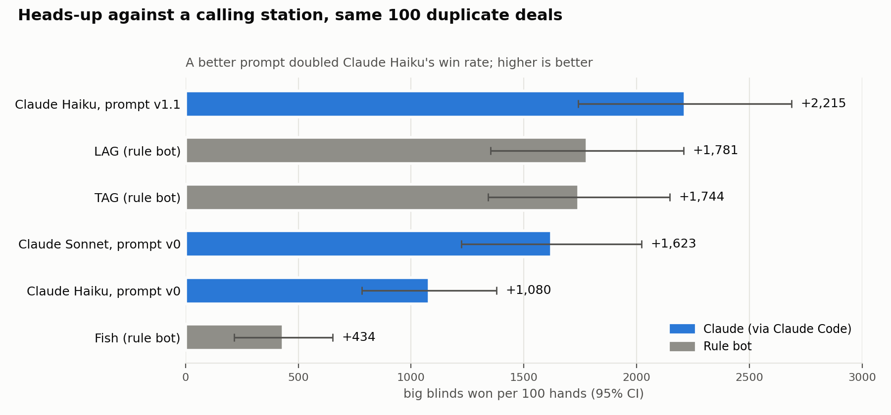
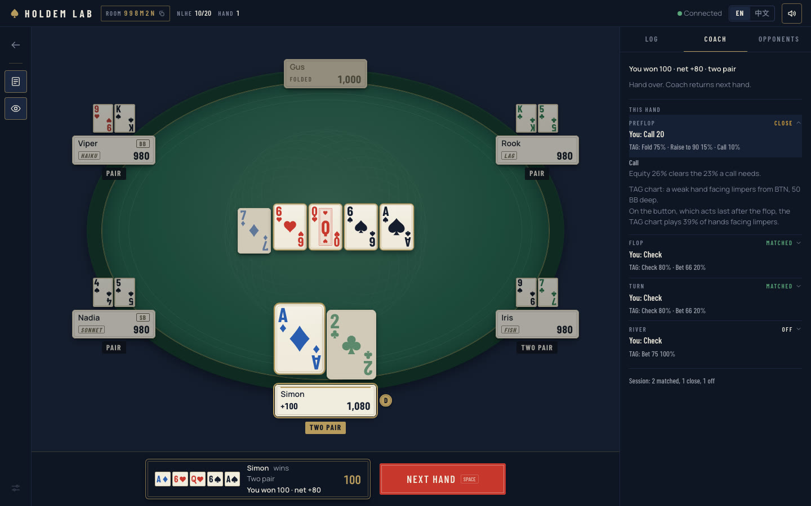

# Holdem Lab

Play no-limit Texas Hold'em against rule bots and Claude, get a coach's read on every decision, and measure how well an LLM actually plays.



## What's in it

- **A full six-seat table** in the browser. Real-time over Socket.io, server-authoritative rules, English and 中文, works on a phone.
- **Five kinds of opponents.** Three rule bots (Fish, TAG, LAG) built on range-based equity and an opponent model, and two Claude bots (Haiku and Sonnet) that run through your local Claude Code.
- **A coach that shows its work.** On your turn it gives the bots' own policy for your spot: the options with their frequencies, your equity against each opponent's likely hands, the price, position and the reasons. It doesn't give one magic answer.
- **A review after every hand.** Each decision you made is graded against that policy as matched, close or off, with a running tally for the session.
- **An eval harness for LLM players.** Duplicate heads-up matches on fixed deals, paired comparisons with confidence intervals, and a per-decision trace of what the model saw and chose.
- **Table sounds** recorded from real chips and cards, with a mute toggle.

## Playing against Claude



A Claude bot is not a chat window. On each of its turns the server:

1. builds what that seat can legally know: its own cards, the board, the action, stack sizes and each opponent's public stats;
2. runs the engine on it and writes a short brief: equity and pot odds, and when one opponent is left, how often that player is likely to fold to each bet size and what each bet is worth;
3. lists the legal moves as lettered options (fold, call, bet a third of the pot, bet the pot, all-in, and so on);
4. starts one isolated `claude -p` (no tools, an empty working directory, no settings or memory) and asks for a letter;
5. checks the answer and plays it, or falls back to the TAG bot if the call times out or the answer is invalid.

The model never sees anyone else's hole cards, and it never does the arithmetic: the numbers come from the engine. Tests check both by re-dealing the hidden cards and confirming the prompt doesn't change. Each Claude bot also keeps a ledger of what every opponent has done in public, so after a few hands its heads-up brief can say things like "this player calls a lot: value-bet big, never bluff".

## What the experiments found



All runs are duplicate heads-up: each deal is played twice with the seats swapped, which cancels most of the card luck. Every Claude call went through Claude Code on a Max plan.

- **Haiku and Sonnet both play sound poker.** Across about 2,500 decisions neither made a single price blunder, such as folding with the odds to call or calling without them. Against the TAG bot both held their own, and 100 deals can't separate them from it.
- **The first prompt left money on the table.** Against a player who never folds, Haiku won about 660 bb/100 less than the TAG bot. The traces showed why: with the best hand on the river it bet a pot-sized amount instead of moving all in, 39 times out of 47. The menu priced every size only as a bluff.
- **Fixing the brief fixed the play.** Prompt v1.1 adds what each bet size is worth against this opponent. Haiku's win rate against the same player went from +1,080 to +2,215 bb/100 on the same deals (+1,135 ± 477), and it lost nothing measurable against TAG.
- **Bluffing is harder.** Against an opponent who folds a lot but keeps strong hands, the bot bluffed by the rules, but the fold estimates were off by up to 30 points. Prompt v1.2 reads the opponent's line within the hand and is better calibrated (Brier 0.269 → 0.227), but the win-rate gain (+170 ± 196) isn't significant yet.

The full method, numbers and the things that didn't work are in [Docs/game-design/bot-eval.md](Docs/game-design/bot-eval.md). In the chart the rule bots' numbers come from the same deals as the prompt v0 runs.

## The coach



The coach uses the same code the bots use, so its advice is exactly what a TAG bot would do in your seat, and it shows its mix rather than pretending to be sure. Advice is built on the server and sent only to you; nothing about other players' cards reaches your browser.

## Quick start

You need Node 22+ and pnpm 10+.

```bash
pnpm install
pnpm dev
```

Open http://localhost:3000, type a name and press **Practice now** to play five rule bots.

### With Claude bots (local only)

Claude bots use the Claude Code CLI on your machine and your own Claude subscription, so they're for your local table only. You need `claude` installed and logged in.

```bash
pnpm --filter @aipoker/shared --filter @aipoker/strategy-engine --filter @aipoker/agent-engine --filter @aipoker/game-engine build
pnpm --filter @aipoker/server eval:cli-canary   # one-time isolation check, about 8 short calls
pnpm --filter @aipoker/server dev:claude-bots
pnpm --filter @aipoker/web dev
```

Then choose **Create a private table**, add Claude Haiku or Claude Sonnet to a seat, and start. Each decision takes 3 to 8 seconds. The server refuses to enable Claude bots if `ANTHROPIC_API_KEY` or `ANTHROPIC_BASE_URL` is set, so calls can't end up billed to an API key by accident. If the plan's usage limit is hit, the Claude seats switch to the TAG bot for the rest of the session.

### Run the evals

```bash
cd apps/server
pnpm simulate:bots --mode duplicate-hu --a tag --b station --hands 3000   # rule bots only, no model calls
pnpm eval:llm-hu --smoke                                                  # 20 Claude calls
pnpm eval:llm-hu --models claude-haiku-5-5 --prompts v1.2 --pilot         # a full run pauses after 10%
```

A full 100-deal run against two opponents is about 1,200 calls and 40 minutes. The commands, gates and stop rules are in [Docs/game-design/bot-eval.md](Docs/game-design/bot-eval.md).

## How it's built

```text
apps/
  server/            Fastify + Socket.io: rooms, the game loop, bots, coach, eval tools
  web/               Next.js 15, React 19, Tailwind v4, Zustand
packages/
  game-engine/       pure TypeScript rules and state transitions
  strategy-engine/   ranges, equity, the opponent model and the rule bots' policy
  agent-engine/      the LLM bot's brief, menu, validator, ledger and prompts
  shared/            types and event contracts shared by server and web
Docs/                specs and eval write-ups
```

`pnpm typecheck`, `pnpm lint` and `pnpm test` run in CI on every pull request (about 670 tests).

Good places to start reading:

- [Docs/game-design/llm-bots.md](Docs/game-design/llm-bots.md): how the LLM bots work, including isolation, the brief and the eval design
- [Docs/game-design/bot-eval.md](Docs/game-design/bot-eval.md): every eval run and what it showed
- [Docs/game-design/coach-advice.md](Docs/game-design/coach-advice.md) and [coach-review.md](Docs/game-design/coach-review.md): the coach
- [apps/web/DESIGN.md](apps/web/DESIGN.md): the visual design system

## Ideas if you fork it

- Fold estimates that also read the board. The bluffing results above say this is the next thing to fix.
- Run the held-out opponents (`calldown`, `size-reader`) and Sonnet on prompt v1.2.
- Put API models and Codex through the same harness. The provider layer is in progress in [#10](https://github.com/SimondXu/holdem-lab/pull/10).
- LLM commentary on the post-hand review, checked by evals. The spec is in [Docs/game-design/coach-commentary.md](Docs/game-design/coach-commentary.md).
- Show which seat is Claude on narrow phone layouts.
- A hosted demo with API-key bots instead of the local CLI.

## Credits

Table sounds are CC0 recordings from [freesound.org](https://freesound.org); authors and links are in [apps/web/public/sounds/README.md](apps/web/public/sounds/README.md).

Built by [Simon Xu](https://simondxu.com) ([github.com/simondxu](https://github.com/simondxu)).

## License

Code: [MIT](LICENSE). The table sounds are CC0 and keep their own credits.
